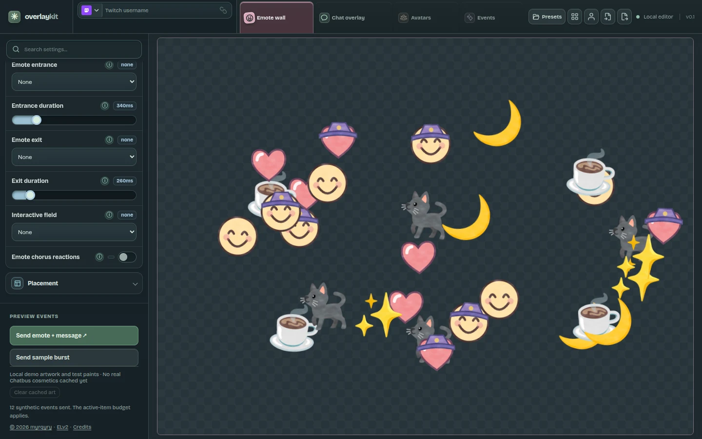
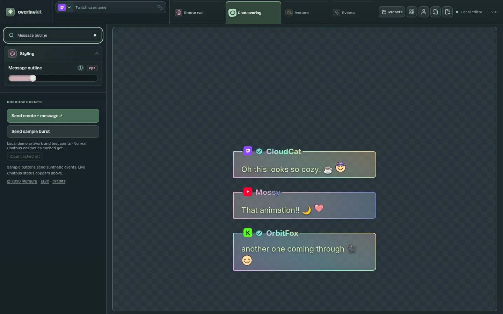
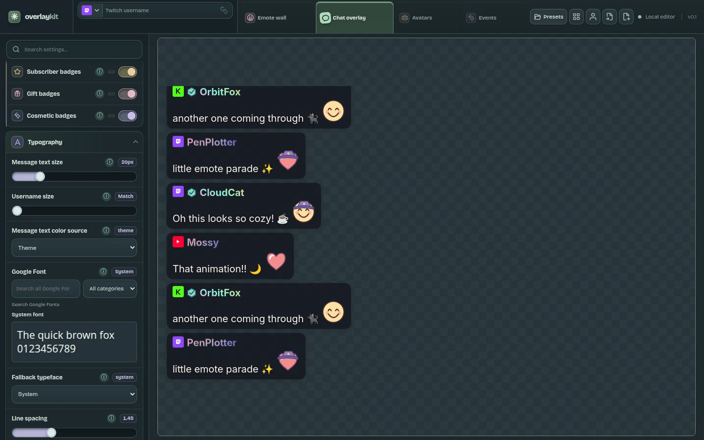

# overlay-kit

**Make chat part of the scene.**

A self-hosted browser-overlay studio for streamers who want their chat and emotes to look like part of their stream, rather than a generic widget.

Mix live chat from Twitch, Kick, YouTube and TikTok, design independent Emote Wall and Chat overlays, and use them as browser sources in OBS.



*Actual Overlay Kit preview with synthetic sample messages and bundled artwork. No live account needed to experiment.*

[Emote Wall](#emote-wall) · [Chat](#chat) · [Get started](#get-started) · [Platform support](#platform-support) · [Documentation](#documentation)

## Emote Wall

Turn chat activity into a moving layer of emotes, with separate controls for how artwork looks, moves, enters and leaves.

- Float, bounce, orbit, sway, flutter, burst or collide; tune speed, size, density and lifetime.
- Mix independent materials, color treatments and edge finishes: cut paper, ink wash, holo foil and more.
- Render stacked and zero-width emotes, supported FFZ modifiers, native platform emotes and optional Unicode emoji.
- React to shared emotes with Emote Chorus, or map chat commands and supported channel events to temporary effects.
- Optionally show Twitch subscriber GIFs.

See [wall materials](docs/wall-materials.md), [motion](docs/motion.md) and [overlay triggers](docs/overlay-triggers.md).

## Chat

Design a chat overlay around your own typography, layout and visual style.



- Vertical stack, horizontal strip or latest-message-only layouts, with independent message and text alignment.
- Flexible message widths, floating nameplates, fonts, spacing, opacity and edge fades.
- Native and third-party emotes, badges, 7TV name paints and supported viewer/source portraits.
- Name-paint backgrounds and outlines, Paper and Phosphor styles, message and letter animations.
- Optional repeat-message grouping, compact links and source-scoped moderation.

<details>
<summary>See the standard chat layout</summary>



</details>

## Get started

Requires **Node.js 24** and **pnpm 11**. No Docker, separate Chatbus checkout or registry token is required.

Clone or download this repository, open a terminal in its folder, then run:

```sh
pnpm install --frozen-lockfile
pnpm live
```

Open [http://127.0.0.1:5219](http://127.0.0.1:5219/).

1. Select **Emote wall** or **Chat overlay** in the control room.
2. Use **Send emote + message** or **Send sample burst** to experiment without connecting a live channel.
3. Choose a platform in the live-source field, enter your channel or YouTube live video ID/URL, and click the link icon or press Enter. Repeat to add another source.
4. Customize the overlay. Hover its workspace tab (or focus it and press Down) and choose **Copy link**.
5. In OBS, add a **Browser Source**, paste the copied URL and set the width and height to suit your layout.

The local relay must remain running; the control room itself can be closed. Ordinary browser-source pages start empty until chat arrives. Sample fixtures are explicitly preview-only, except when you intentionally send a sample to open same-origin sources.

### Preview without live connections

```sh
pnpm dev:vite
```

Open the address printed in the terminal. This starts the editor and synthetic previews without the local Chatbus relay.

### Development

```sh
pnpm dev
pnpm test
pnpm typecheck
pnpm build
```

The development host defaults to port 5173. The standalone host defaults to 5219 and binds to loopback. See the [technical reference](TECHNICAL.md) for alternate ports, OAuth setup, hosted deployment and architecture.

## Browser-only hosting

The public source supports a free static GitHub Pages build. Browser mode uses
the pinned Chatbus browser entrypoint and connects directly to Twitch IRC and Kick Pusher,
with existing emote, badge and cosmetic enrichment where provider APIs permit.
The editor and independently opened OBS source pages do not need our server.

```sh
pnpm build:pages
```

Deploy only `dist-pages/`. The build uses relative project-site assets.
Twitch and Kick public chat connect directly. Kick uses the public Pusher
transport descriptor refreshed by Chatbus's GitHub Pages publisher; its
Centrifugo negotiation remains Node-only because of CORS. YouTube has an
optional official Data API browser preview; its anonymous web reader and
TikTok still require the local `pnpm live` editor. No browser security
checks are bypassed. Provider availability can change.

### Hybrid hosted deployment

The normal Vercel build serves the same frontend and connects Twitch and
Kick directly from the user's browser. YouTube and TikTok retain the
same-origin hosted relay, including anonymous YouTube. All enabled editor
previews share one normalized chat connection per selected channel rather
than opening their own provider connections, badge catalogs and cosmetic
lookups. Standalone OBS sources remain independent. Local self-hosted mode
keeps its existing relay and OAuth behavior. GitHub Pages remains available
for entirely static hosting.

### Optional YouTube browser preview (API key required)

In Google Cloud, enable YouTube Data API v3 and create a dedicated API key
restricted to that API and the website `https://myrqyry.github.io/*`.
In the Pages editor, open Accounts → YouTube and save the restricted key,
then add the live video URL or ID. The key is stored only on explicit request
in that browser profile and is sent to Google in an API header, not in
overlay URLs, presets, exports, or our servers. It is browser-visible; never
enter unrestricted keys, OAuth tokens or client secrets.

OBS may have its own browser profile: temporarily load
[youtube-setup.html](https://myrqyry.github.io/overlay-kit/youtube-setup.html)
in the hidden source, use Interact to save the key, then restore its normal
overlay URL. Forgetting the key stops active YouTube readers in that profile.
The editor shares one reader per selected video among its previews.
Independent browser sources consume their own API quota; polling is no faster
than ten seconds or Google's requested interval. Quota and API restrictions
apply. Use the local relay if you need anonymous public YouTube chat.
The browser integration is fixture-tested; real credentialed YouTube chat
and OBS CEF storage persistence are not yet verified.


## Platform support

Overlay Kit combines sources in one normalized chat stream. Provider capabilities differ; connecting successfully does not imply full moderation, badge or channel-event coverage.

| Platform | Connection | Notes |
| --- | --- | --- |
| Twitch | Anonymous IRC; optional local authenticated EventSub | Native emotes and supported cosmetics; richer events depend on authorization. |
| Kick | Public web realtime | Native emotes and supported badges; unofficial transport, not the official chat API. |
| YouTube | Official Live Chat API with server credentials or optional browser key; Node public reader | Public reader uses undocumented endpoints and has reduced event coverage. |
| TikTok | Optional server-side public LIVE connector | Unofficial signing service; native TikTok emote and badge art is not implemented. |

BTTV, FFZ and 7TV cosmetics are resolved through Chatbus where available. Some badge/identity lookups use third-party services. Unofficial providers may change or become unavailable; failures should not be mistaken for successful connections.

## Optional artwork

Overlay Kit loads native badge image URLs directly. On a Kick connection its shared Chatbus badge catalog also attempts to acquire the original moderator, verified, Gift1 and Gift25 SVG artwork from Kick’s publicly delivered website assets, without bundling the graphics or executing downloaded scripts. This undocumented best-effort lookup runs in the background and falls back to text if unavailable. If you prefer to have authorized personal artwork available as an offline fallback, install it with:

```sh
pnpm art:install "/path/to/your/png-folder"
pnpm live
```

See [optional Kick artwork](docs/kick-badges.md#optional-personal-artwork) for accepted filenames and details. Your local artwork is ignored by Git and is only included in your own build. For a distributable build, use a clean checkout without personal artwork.

## Control room

Each overlay has independent settings and a dedicated browser-source URL. Preview changes, save presets, compare views, export/import settings, and connect or disconnect individual sources without restarting the entire overlay.

**Avatars and Events** are additional experimental workspaces. They are not required for the Wall or Chat workflow.

## Project status

Early preview (v0.1.0). Local relay and browser behavior have existing automated and Chromium verification, including documented real-provider checks. Native OBS CEF and sustained high-volume performance still require dedicated verification. The screenshots above were captured from the actual browser editor with synthetic fixtures, not live-stream footage.

## Documentation

| Guide | Contents |
| --- | --- |
| [Technical reference](TECHNICAL.md) | Installation details, live relay, provider boundaries, deployment, architecture and historical verification |
| [Wall materials](docs/wall-materials.md) | Material, color and edge composition |
| [Motion](docs/motion.md) | Animation and presentation behavior |
| [Style packs](docs/style-packs.md) | Local presentation styles |
| [Overlay triggers](docs/overlay-triggers.md) | Command and channel-event effects |
| [Name paints](docs/name-paints.md) | 7TV name and message paint rendering |
| [Preview cosmetics](docs/preview-cosmetic-cache.md) | Synthetic previews and local asset cache |
| [Twitch subscriber GIFs](docs/twitch-subscriber-gifs.md) | Chat and optional Wall GIF support |

## License

Overlay Kit's original project material is **source-available under the [Elastic License 2.0](LICENSE)** (ELv2), not an OSI-approved open-source license.

Streamers may use and self-host it on monetized streams. You may modify and redistribute covered software subject to ELv2, including keeping licensing and attribution notices and identifying modified copies. Providing others with substantial Overlay Kit functionality as a hosted or managed service is not permitted under ELv2, even if that service is free. Separate commercial licensing requires written permission from the relevant rights holder.

The source release does not bundle third-party npm implementation code; the normal installation fetches pinned packages directly. See [NOTICE](NOTICE) for project attribution and third-party boundaries, [third-party notices](THIRD_PARTY_NOTICES.txt) for dependency license texts, and [release readiness](docs/release-readiness.md) for distribution verification. Third-party dependencies, platform artwork and remote cosmetics retain their own terms; this license does not grant rights to those materials. The full license text governs in case of any discrepancy.
